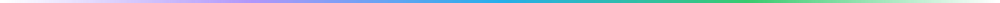

<div align="center">

<picture>
  <source media="(prefers-color-scheme: dark)" srcset="./assets/logo-dark.svg">
  
</picture>

# IG-Munfollow

**Descubre quién no te sigue de vuelta en Instagram y deja de seguir en masa. Funciona en la consola del navegador, sin instalación, sin contraseña y sin intermediarios.**

[](./LICENSE)
[](https://github.com/Miabeyefendi/IG-Munfollow/releases/latest)
[](#-instalación)
[](#)
[](https://github.com/Miabeyefendi)

[English](./README.md) · [Türkçe](./README_TR.md) · **Español** · [简体中文](./README_ZH.md) · [Русский](./README_RU.md)

[Instalación](#-instalación) · [Funciones](#-lo-destacado) · [Uso](#-inicio-rápido) · [Ajustes](#️-configuración) · [Cambios](./CHANGELOG.md)

<a href="https://github.com/Miabeyefendi/IG-Munfollow/releases/latest">
  
</a>
<a href="./CHANGELOG.md">
  <picture>
    <source media="(prefers-color-scheme: dark)" srcset="./assets/btn-changelog-dark.svg">
    
  </picture>
</a>

</div>

---

## ✨ Lo destacado

- **No se instala nada y no se comparte la contraseña** - un solo script, pegado en tu propia consola en una página donde ya has iniciado sesión. No hay ninguna app por medio, así que no hay a quién entregar tus credenciales.
- **Ocho formas de dividir tus listas** - todos a quienes sigues, los que no te siguen de vuelta, los mutuos, las cuentas privadas, las verificadas, las que no tienen foto de perfil, los mejores amigos, y los seguidores a los que no sigues.
- **Ordena por cuándo los seguiste** - de más reciente a más antiguo para revisar errores recientes, o al revés para limpiar a quienes seguiste hace años y olvidaste.
- **Ritmo antibloqueo** - espera aleatoria entre acciones con mínimo y máximo configurables, más una pausa automática tras un número dado de dejadas de seguir.
- **Estadísticas en vivo** - total escaneado, los que no te siguen, mutuos, seleccionados y un contador de dejadas de seguir con éxito.
- **Selecciona todo, o elige a mano** - la lista es tuya para revisarla antes de que ocurra nada.
- **Interfaz en tres idiomas** - inglés, turco y español, se cambia dentro del panel.
- **Flota sobre Instagram** - el panel se sitúa encima sin romper la maquetación de la página.

---

## 📦 Instalación

### Requisitos

| | |
|---|---|
| Navegador | Chrome, Edge o Firefox en escritorio |
| Cuenta | Una cuenta de Instagram con la sesión iniciada en `www.instagram.com` |
| Instalación | Ninguna. Es un único script de consola. |


### Conseguir el script

Abre [`Munfollow.js`](./Munfollow.js) y copia el archivo entero. Ese es todo el programa.

<details>
<summary><b>¿Prefieres clonarlo?</b></summary>

```bash
git clone https://github.com/Miabeyefendi/IG-Munfollow.git
```

Sin compilación y sin dependencias. Abre el archivo `.js` y copia su contenido.

</details>

---

## 🚀 Inicio rápido

1. Entra en [www.instagram.com](https://www.instagram.com/) desde escritorio e inicia sesión.
2. Abre la consola. `F12` o `Ctrl + Shift + J` en Chrome y Edge, `Ctrl + Shift + K` en Firefox. En Mac, `Cmd + Option + J`.
3. Pega el script completo y pulsa Enter.
4. El panel aparece sobre la página. Pulsa **Scan Following**.

El script solo se ejecuta en `www.instagram.com` y se detiene de inmediato en cualquier otro sitio.

Tras el escaneo verás los recuentos y la lista de usuarios. Elige un filtro, revisa las filas, marca lo que quieras y pulsa **Unfollow Selected**. No pasa nada hasta que confirmes.

> **No bajes las esperas en tu primera tanda.** Instagram es más estricto con dejar de seguir que con casi cualquier otra cosa automatizable. Los valores por defecto son conservadores a propósito, y la tanda rápida es la que acaba con un bloqueo de acciones.

---

## ⚙️ Configuración

Todo se ajusta en el panel, no se edita nada en el archivo.

### Filtros

| Filtro | Muestra |
|---|---|
| All Following | Todas las personas a las que sigues |
| Non-Followers | Personas que sigues y no te siguen de vuelta |
| Mutuals | Personas que sigues y también te siguen |
| Private Accounts | Cuentas con perfil privado |
| Verified Accounts | Cuentas con la insignia de verificación |
| No Profile Picture | Cuentas que nunca pusieron avatar, normalmente abandonadas o falsas |
| Close Friends | Cuentas de tu lista de mejores amigos |
| Followers Not Followed Back | Personas que te siguen y a las que no sigues; las filas seleccionadas se quitan como seguidores |

### Ordenación

| Opción | Orden |
|---|---|
| Newest to Oldest | Los seguidos más recientemente primero |
| Oldest to Newest | Los seguimientos más antiguos primero |

### Antibloqueo

| Ajuste | Qué hace |
|---|---|
| Min Delay (s) | Límite inferior de la espera aleatoria entre acciones |
| Max Delay (s) | Límite superior de esa espera |
| Auto Pause (Actions) | Hacer una pausa tras este número de acciones |
| Pause Duration (s) | Cuánto dura esa pausa |

**El ritmo, en términos claros.** Antes de cada acción el script espera un número aleatorio de segundos entre el mínimo y el máximo, y cuando alcanza el número de la pausa automática se detiene por completo durante la duración indicada. La aleatoriedad importa más que las cifras en sí: un intervalo fijo es lo más fácil del mundo de detectar.

---

## 📖 Documentación

- [**Cambios**](./CHANGELOG.md) - qué cambió en cada versión
- [**Contribuir**](./CONTRIBUTING.md) - cómo enviar un cambio
- [**Seguridad**](./SECURITY.md) - cómo informar de una vulnerabilidad en privado

---

## ❓ Preguntas frecuentes

<details>
<summary><b>¿Puede bloquearme las acciones la cuenta?</b></summary>

Sí, puede, y dejar de seguir es la acción que Instagram vigila más de cerca. Esta herramienta se autorregula con esperas aleatorias y pausas programadas para mantenerse en un rango humano, pero ningún ritmo es una garantía. Deja esperas generosas, trabaja en tandas pequeñas y para por hoy si ves un aviso. Asumes el riesgo, consulta el Descargo de responsabilidad.

</details>

<details>
<summary><b>¿Tengo que darle mi contraseña?</b></summary>

No, y no podría usarla. El script se ejecuta dentro de una página donde ya has iniciado sesión y usa esa sesión, igual que si pulsaras los botones tú. Nunca ve tus credenciales y nunca envía nada a terceros. Esa es toda la razón de que esto sea un script de consola y no una app.

</details>

<details>
<summary><b>¿Qué es una cuenta "sin foto de perfil"?</b></summary>

Una cuenta que nunca puso avatar. Combinada con el filtro de los que no te siguen, es la forma más rápida de encontrar las cuentas abandonadas y falsas que engordan tu lista de seguidos.

</details>

<details>
<summary><b>¿Dejará de seguir a mis mejores amigos por error?</b></summary>

No, salvo que los selecciones. Los mejores amigos tienen su propio filtro para que puedas revisar esa lista a propósito, ya sea para protegerla o para repasarla.

</details>

<details>
<summary><b>El panel no apareció.</b></summary>

Comprueba que estás en `www.instagram.com` y no en un subdominio ni en la versión móvil, y que la consola no ha dado un error. Algunos navegadores exigen escribir `allow pasting` una vez en la consola antes de aceptar código pegado.

</details>

<details>
<summary><b>Se paró a mitad.</b></summary>

Cerrar o recargar la pestaña termina la ejecución. Las acciones ya completadas siguen completadas. Vuelve a escanear y la lista reflejará el estado nuevo.

</details>

---

## 🤝 Contribuir

Las contribuciones son bienvenidas. Lee primero [CONTRIBUTING.md](./CONTRIBUTING.md) y [CODE_OF_CONDUCT.md](./CODE_OF_CONDUCT.md). Al contribuir aceptas licenciar tu trabajo bajo la AGPL-3.0.

<div align="center">
<a href="https://github.com/Miabeyefendi/IG-Munfollow/issues/new?template=bug_report.yml">
  <picture>
    <source media="(prefers-color-scheme: dark)" srcset="./assets/btn-report-bug-dark.svg">
    
  </picture>
</a>
<a href="https://github.com/Miabeyefendi/IG-Munfollow/stargazers">
  <picture>
    <source media="(prefers-color-scheme: dark)" srcset="./assets/btn-star-dark.svg">
    
  </picture>
</a>
</div>

---

## 🛡️ Seguridad

¿Has encontrado una vulnerabilidad? No abras una incidencia pública. Sigue el proceso privado descrito en [SECURITY.md](./SECURITY.md).

---

## 📜 Licencia

IG-Munfollow está licenciado bajo la **GNU Affero General Public License v3.0 (AGPL-3.0)**, junto con los términos suplementarios del archivo [NOTICE](./NOTICE). En resumen:

- Puedes usar, estudiar, modificar, redistribuir e incluso ganar dinero con esta obra de forma gratuita, **siempre que** mantengas el código fuente completo disponible bajo la AGPL-3.0, incluido cualquier uso alojado, SaaS o en red (AGPL Sección 13), y conserves la atribución de autoría indicada abajo.
- Para usar esta obra en un producto propietario o de código cerrado, o para ejecutarla como un SaaS cerrado, necesitas una **licencia comercial escrita aparte**, que puede incluir regalías o reparto de ingresos. Consulta [NOTICE](./NOTICE), Sección 8, y contacta conmigo.

### Atribución (obligatoria)

Según la Sección 7(b) de la AGPL-3.0, la siguiente atribución debe conservarse de forma visible y sin modificar en cualquier copia, bifurcación o despliegue de este proyecto:

> **Miabeyefendi (Mustafa Ihsan Albayrak)** - https://github.com/Miabeyefendi

### Descargo de responsabilidad

Este software se proporciona "tal cual", sin garantía de ningún tipo. Lo ejecutas por tu cuenta y riesgo y eres la única persona responsable de tu propio uso, incluido el cumplimiento de los términos de servicio de cualquier plataforma de terceros con la que interactúe, en particular Instagram. Instagram no está afiliado a este proyecto ni lo respalda; su nombre y sus marcas pertenecen a su propietario. El autor no acepta responsabilidad alguna por bloqueos de cuenta, bloqueos de acciones, pérdida de datos ni ningún otro daño, en la máxima medida permitida por la ley aplicable. Los términos completos están en los archivos [LICENSE](./LICENSE) y [NOTICE](./NOTICE).

---

## 📬 Contacto

- GitHub: [@Miabeyefendi](https://github.com/Miabeyefendi)
- Para licencias comerciales o consultas sobre reparto de ingresos, escríbeme a través de mi perfil de GitHub.

<div align="center">
<br/>

<br/>
<sub>Creado por <b><a href="https://github.com/Miabeyefendi">Miabeyefendi</a></b></sub>
</div>
